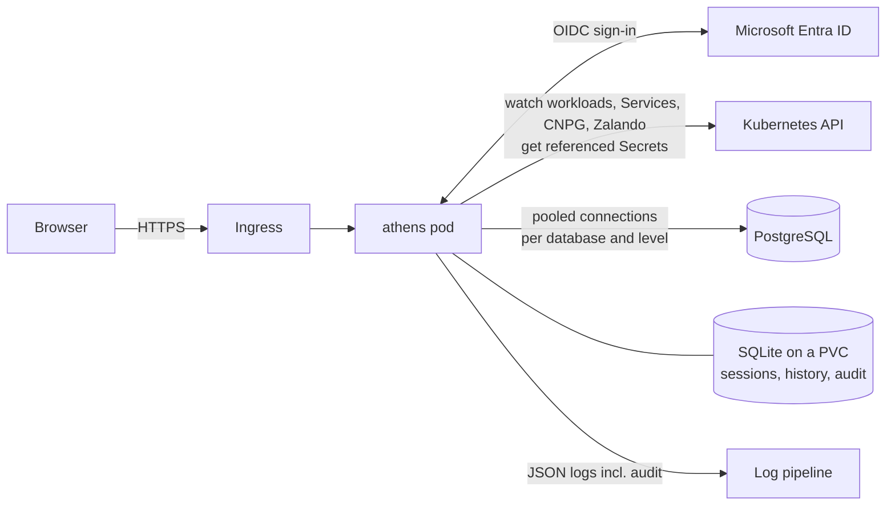

<p align="center">
  
</p>

<h1 align="center">athens</h1>

<p align="center">
  PostgreSQL web client for Kubernetes, with Microsoft Entra ID sign-in,<br>
  database discovery by annotation and a full audit log.
</p>

athens is a PostgreSQL web client that runs inside your Kubernetes cluster.
Users sign in with Microsoft Entra ID and see the databases their groups may
use. They can browse schemas and data, edit rows and run SQL. Every action is
checked on the server and recorded in an audit log, and database passwords
never leave the backend.

- **Entra ID single sign-on** (OIDC with PKCE). No local accounts; access
  follows your Entra groups.
- **Databases appear by annotation.** Annotate a StatefulSet, Deployment,
  Service, CloudNativePG `Cluster` or Zalando `postgresql` with
  `athens.warewave.io/enabled: "true"` and it shows up within a second.
  Credentials are found automatically in the container env or the operator
  Secrets.
- **Per-group and per-database access:**
  - `read` or `write` levels set by rules in the configuration;
  - or by the database's owners with the `readonly` and `access`
    annotations.
  - Read access always runs in `READ ONLY` transactions, with a separate
    read-only login when one is configured.
- **Data grid** with sorting, filters, paging and CSV export. Rows can be
  edited in place, and athens detects conflicting edits instead of
  overwriting them.
- **SQL editor** with autocomplete, history, saved queries and drafts.
  Destructive statements, and every change on production databases, need
  confirmation.
- **Audit log** of sign-ins, queries, reads and changes. Admins can search it
  in the UI, export it to CSV or JSON Lines, and the stdout copy can be
  shipped to append-only storage.
- **One small container:** a static Go binary with an embedded UI and SQLite
  state, running under the restricted Pod Security profile.

## Contents

- [How it works](#how-it-works)
- [Try it locally](#try-it-locally)
- [Install](#install)
- [Add a database](#add-a-database)
- [Control access](#control-access)
- [Audit](#audit)
- [Security model](#security-model)
- [Documentation](#documentation)
- [Development](#development)

## How it works



1. athens watches the namespaces you list. Each annotated object becomes a
   **target**: a host, a port and references to the Secret keys that hold
   the login. athens stores the references, never the values.
2. A user signs in through Entra ID. athens reads the user's group IDs from
   the token.
3. For each request, athens works out the user's level on that database:
   none, `read` or `write`. Users who have no access to a database don't see
   it at all.
4. Queries run on pooled connections. Every statement runs in its own
   transaction with `application_name = athens:<email>`, a statement timeout
   and a lock timeout. For read users the transaction is `READ ONLY`.
5. Sign-ins, editor runs, grid reads and writes, and admin actions are
   written to the audit log and to stdout.

## Try it locally

You need Docker, [kind](https://kind.sigs.k8s.io), kubectl, helm, Go 1.26+
and Node 22+ with pnpm. The setup below does not touch your current
kubectl context.

```bash
./hack/kind/cluster.sh        # kind cluster "athens-dev" with the plain demo databases
```

```bash
./hack/kind/port-forward.sh   # keep running in its own terminal
```

```bash
make dev                      # mock Entra ID :7082, athens :7080, Vite :5173
```

Open <http://localhost:7080> and sign in. The mock identity provider lets you
pick a user:

| User | Groups | Sees |
|---|---|---|
| Dev Admin | `dev-admins`, `dev-writers` | every demo database with write access, plus Administration |
| Wanda Writer | `dev-writers` | every demo database with write access |
| Rita Reader | `dev-readers` | every demo database, read only |
| Otto Outsider | `some-other-group` | nothing (the empty state) |

The demo namespace `athens-demo` contains several database setups:
- a plain StatefulSet;
- a Deployment with a literal password;
- a `_FILE`-mounted password;
- a legacy database with an explicit login and a read-only login.

`make e2e` uses the same cluster and adds CloudNativePG, Zalando and Bitnami
databases. Try the access annotations on one of them:

```bash
export KUBECONFIG=hack/kind/.kube/config
kubectl -n athens-demo annotate deployment scratch-db athens.warewave.io/readonly=true athens.warewave.io/access=dev-readers:rw
```

Rita now sees `scratch-db` read only, while Dev Admin and Wanda no longer see
it. To remove the annotations:

```bash
kubectl -n athens-demo annotate deployment scratch-db athens.warewave.io/readonly- athens.warewave.io/access-
```

## Install

### 1. Register the Entra ID application

1. **Entra admin center → App registrations → New registration**
   - Name: `athens`
   - Supported account types: *Accounts in this organizational directory only*
   - Redirect URI: platform **Web**, `https://athens.example.com/auth/callback`
2. **Certificates & secrets → New client secret.** Copy the value; it is
   shown only once.
3. **Token configuration → Add groups claim** → **Groups assigned to the
   application**, emitted as group IDs in the ID token. With this option, a
   user in many groups still gets a groups claim; athens refuses the overage
   claim Entra sends for more than 200 groups (ADR-007).
4. **Enterprise applications → athens → Properties:** set *Assignment
   required?* to **Yes**. Then under **Users and groups**, assign every group
   you use in athens rules, admin groups and `access` annotations.
5. Note the **Directory (tenant) ID** and the **Application (client) ID**.

### 2. Create the Secret

```bash
kubectl create namespace athens
```

```bash
kubectl -n athens create secret generic athens \
  --from-literal=clientSecret='<client secret from step 1.2>' \
  --from-literal=sessionKey="$(openssl rand -base64 32)"
```

### 3. Write your values

```yaml
# values.yaml
config:
  server:
    baseURL: https://athens.example.com
    trustedProxies: ["10.244.0.0/16"]      # ingress controller pod CIDR, for client IPs in the audit log
  oidc:
    issuer: https://login.microsoftonline.com/<TENANT_ID>/v2.0
    clientID: <APPLICATION_CLIENT_ID>
  authz:
    adminGroups: ["<GROUP_ID_PLATFORM_ADMINS>"]
    groupAliases:                          # names for access annotations
      platform: "<GROUP_ID_PLATFORM_ADMINS>"
      dba: "<GROUP_ID_DBA>"
      payments-dev: "<GROUP_ID_PAYMENTS_DEV>"
    rules:
      - name: dba
        groups: ["<GROUP_ID_DBA>"]
        namespaces: ["*"]
        level: write
      - name: payments-read
        groups: ["<GROUP_ID_PAYMENTS_DEV>"]
        namespaces: ["payments"]
        level: read
      - name: payments-write-staging
        groups: ["<GROUP_ID_PAYMENTS_DEV>"]
        namespaces: ["payments-staging"]
        level: write
  discovery:
    namespaces: ["payments", "payments-staging", "orders"]   # a Role is created in each
secret:
  existingSecret: athens
ingress:
  enabled: true
  className: nginx
  host: athens.example.com
  tls:
    - hosts: [athens.example.com]
      secretName: athens-tls
networkPolicy:
  ingressNamespaceSelector:
    kubernetes.io/metadata.name: ingress-nginx
serviceMonitor:
  enabled: true
```

All settings: [docs/CONFIGURATION.md](docs/CONFIGURATION.md).

### 4. Install the chart

```bash
helm upgrade --install athens deploy/helm/athens -n athens -f values.yaml
```

```bash
kubectl -n athens rollout status deploy/athens
```

```bash
kubectl -n athens port-forward deploy/athens 8080:8080
```

```bash
curl -s localhost:8080/readyz
```

`readyz` returns `{"discovery":true,"oidc":true,"store":true}` when athens is
ready. Open `https://athens.example.com` and sign in.

What the chart deploys:
- **One pod** running under Pod Security `restricted`, with a read-only root
  file system.
- **A 1 GiB PVC** for the SQLite store. athens runs as a single replica with
  the `Recreate` strategy (ADR-003).
- **A Role per discovery namespace** that can read workloads, Services and
  operator resources, and `get` (not `list`) Secrets.
- **A NetworkPolicy**, on by default. It allows ingress from the ingress
  controller and egress to the API server, Entra ID, DNS and Postgres in the
  discovery namespaces.

## Add a database

Annotate the object that runs it:

```bash
kubectl -n payments annotate statefulset orders-db athens.warewave.io/enabled=true
```

That is usually all. athens finds the Service and reads the login from the
container env. Add annotations for an explicit login, a read-only login, a
display name or the production badge:

```yaml
metadata:
  annotations:
    athens.warewave.io/enabled: "true"
    athens.warewave.io/secret: billing-db-admin        # keys username / password
    athens.warewave.io/readonly-secret: billing-db-ro  # used for read users
    athens.warewave.io/display-name: Billing
    athens.warewave.io/environment: production         # typed confirmation for every change
```

CloudNativePG and Zalando clusters are annotated the same way on the
`Cluster` / `postgresql` resource:

```bash
kubectl -n payments annotate clusters.postgresql.cnpg.io payments athens.warewave.io/enabled=true
```

Recipes for plain StatefulSets, Bitnami, CNPG, Zalando and databases outside
the cluster, with tested manifests: [docs/DATABASES.md](docs/DATABASES.md).

## Control access

Configuration rules map Entra groups to databases:

```yaml
authz:
  rules:
    - {name: dba, groups: ["<GROUP_ID_DBA>"], namespaces: ["*"], level: write}
    - {name: bi, groups: ["<GROUP_ID_BI>"], namespaces: ["orders"], databases: ["reporting"], level: read}
```

The team that owns a database can override this next to the database:

```yaml
metadata:
  annotations:
    athens.warewave.io/readonly: "true"                  # everyone gets read only
    athens.warewave.io/access: "dba:rw, payments-dev:ro" # only these groups see it
```

`access` replaces the rules for that database, and with `readonly` everyone
on the list is read only. Group names come from `authz.groupAliases`; group
IDs also work. Evaluation order, worked examples and guardrails:
[docs/ACCESS-CONTROL.md](docs/ACCESS-CONTROL.md).

## Audit

| Event | When |
|---|---|
| `login`, `login_denied`, `logout` | sign-in and sign-out |
| `query_execute`, `query_cancel` | every SQL editor run (reads included) and cancellation |
| `rows_read`, `cell_read`, `structure_view` | grid pages, full cell values, table structure (`audit.logReads`) |
| `row_insert`, `row_update`, `row_delete` | grid changes, with primary keys and column names |
| `access_denied`, `confirm_required` | refused or not yet confirmed statements |
| `saved_query_create/update/delete`, `history_delete` | changes to a user's saved items |
| `admin_view`, `audit_export` | administration pages and exports |

Records go to the SQLite store, which admins can browse and export, and to
stdout as JSON with `"log":"audit"`. Ship the stdout copy to append-only
storage; examples for Fluent Bit, Vector and Loki are in
[docs/OPERATIONS.md](docs/OPERATIONS.md#audit-trail).

```json
{"time":"2026-11-12T09:41:07.12+00:00","level":"INFO","msg":"audit","app":"athens","log":"audit","event":"query_execute","ts":"2026-11-12T09:41:07.118Z","result":"ok","user_id":"5d0c…","email":"ayse@example.com","client_ip":"10.20.4.17","target_id":"payments/ledger","database":"ledger","statement_class":"dml","sql":"update invoices set status = 'void' where id = 4711","rows_affected":1,"duration_ms":14}
```

## Security model

- **Credentials** are read from Secrets when a connection pool is created and
  kept in memory only. They never appear in API responses, logs, the audit
  trail, metrics or the SQLite store.
- **Authorization** is checked on the server for every request. A database
  you may not use returns 404, so its name does not leak.
- **Generated SQL** (grid, filters, edits) quotes identifiers and passes
  every value as a bind parameter.
- **Statements are classified** with the PostgreSQL parser. Read users can
  only read, functions with side effects count as writes, and destructive
  statements need confirmation.
- **Browser security:** strict CSP, CSRF tokens, HttpOnly + SameSite session
  cookies, HSTS, a 1 MiB request limit and per-user query concurrency
  limits.

Details: [docs/SPEC.md](docs/SPEC.md) and the decisions in
[docs/DECISIONS.md](docs/DECISIONS.md).

## Documentation

| Document | For | Contents |
|---|---|---|
| [USER-GUIDE.md](docs/USER-GUIDE.md) | users | workspace, grid, editing, SQL editor, confirmations, shortcuts |
| [DATABASES.md](docs/DATABASES.md) | database owners | annotation recipes, read-only logins, access annotations, troubleshooting |
| [ACCESS-CONTROL.md](docs/ACCESS-CONTROL.md) | operators, owners | levels, rules, annotations, evaluation order, examples |
| [CONFIGURATION.md](docs/CONFIGURATION.md) | operators | every setting, environment overrides, flags, Helm values |
| [OPERATIONS.md](docs/OPERATIONS.md) | operators | health, metrics, backups, upgrades, secret rotation, audit shipping, troubleshooting |
| [SPEC.md](docs/SPEC.md) | developers | architecture and security model |
| [DISCOVERY.md](docs/DISCOVERY.md) | developers | exact discovery and credential rules |
| [API.md](docs/API.md) | developers | REST API |
| [DECISIONS.md](docs/DECISIONS.md) | everyone | architecture decision records |

## Development

Requirements: Go 1.26+, Node 22+ with pnpm, Docker, kind, helm.

| Command | Does |
|---|---|
| `make build` | web build and Go binary with the UI embedded (`bin/athens`) |
| `make dev` | mock IdP, athens with `--dev` and Vite with hot reload |
| `make test` | Go and web unit tests |
| `make test-int` | integration tests against PostgreSQL 16 and 13 (testcontainers, needs Docker) |
| `make e2e` | kind cluster with CNPG, Zalando, Bitnami and plain fixtures, plus the end-to-end suite |
| `make lint` | golangci-lint, eslint, tsc, helm lint and kubeconform |
| `make image` | distroless container image |

Code layout and working rules: [CLAUDE.md](CLAUDE.md) and
[docs/TASKS.md](docs/TASKS.md).
