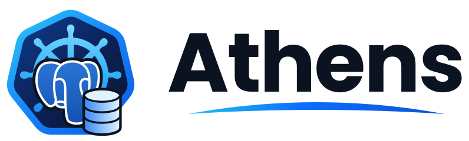
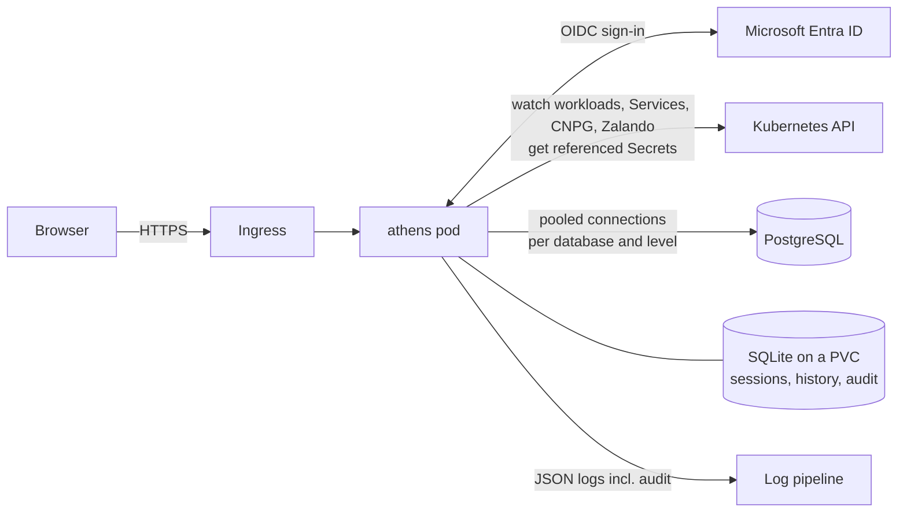

<p align="center">
  <picture>
    <source media="(prefers-color-scheme: dark)" srcset="docs/assets/brand/athens-logo-dark.svg">
    
  </picture>
</p>

<p align="center">
  PostgreSQL web client for Kubernetes, with Microsoft Entra ID sign-in,<br>
  database discovery by annotation and a full audit log.
</p>

athens is a PostgreSQL web client that runs inside your Kubernetes cluster.
Users sign in with Microsoft Entra ID and see the databases their groups may
use. They can browse schemas and data, edit rows and run SQL. Every action is
checked on the server and recorded in an audit log, and database passwords
never leave the backend.

- **Entra ID single sign-on** (OIDC with PKCE). No local accounts; access
  follows your Entra groups.
- **Everything is an annotation.** Two lines on a StatefulSet, Deployment,
  Service, CloudNativePG `Cluster` or Zalando `postgresql` put a database in
  athens and say who may use it:
  ```yaml
  athens.warewave.io/enabled: "true"
  athens.warewave.io/access: "dba:rw, payments-dev:ro"
  ```
  The database shows up within a second, anywhere in the cluster. athens
  finds the endpoint and the login in the container env or the operator
  Secrets. The athens configuration has no list of databases and no access
  rules.
- **Read-only where it matters:** `athens.warewave.io/readonly: "true"`
  caps everyone at read. Read users never touch the main login: they
  connect with a read-only login, your own (`readonly-secret`) or one athens
  creates and manages (`readonly-provision: "true"`), always in `READ ONLY`
  transactions.
- **Data grid** with sorting, filters, paging and CSV export. Rows can be
  edited in place, and athens detects conflicting edits instead of
  overwriting them.
- **SQL editor** with autocomplete, history, saved queries and drafts.
  Destructive statements, and every change on production databases, need
  confirmation.
- **Audit log** of sign-ins, queries, reads and changes. Admins can search it
  in the UI, export it to CSV or JSON Lines, and the stdout copy can be
  shipped to append-only storage.
- **One small container:** a static Go binary with an embedded UI and SQLite
  state, running under the restricted Pod Security profile.

## Contents

- [How it works](#how-it-works)
- [Try it locally](#try-it-locally)
- [Install](#install)
- [Add a database](#add-a-database)
- [Control access](#control-access)
- [Audit](#audit)
- [Security model](#security-model)
- [Documentation](#documentation)
- [Development](#development)
- [License](#license)

## How it works



1. athens watches the cluster (or the namespaces you list). Each annotated
   object becomes a **target**: a host, a port, the access list from its
   annotation, and references to the Secret keys that hold the login. athens
   stores the references, never the values.
2. A user signs in through Entra ID. athens reads the user's groups from the
   token.
3. For each request, athens matches the user's groups against the target's
   access list: none, `read` or `write`. Users who are not on the list don't
   see the database at all.
4. Queries run on pooled connections. Every statement runs in its own
   transaction with `application_name = athens:<email>`, a statement timeout
   and a lock timeout. For read users the transaction is `READ ONLY`.
5. Sign-ins, editor runs, grid reads and writes, and admin actions are
   written to the audit log and to stdout.

## Try it locally

You need Docker, [kind](https://kind.sigs.k8s.io), kubectl, helm, Go 1.26+
and Node 22+ with pnpm. The setup below does not touch your current
kubectl context.

```bash
./hack/kind/cluster.sh        # kind cluster "athens-dev" with the plain demo databases
```

```bash
./hack/kind/port-forward.sh   # keep running in its own terminal
```

```bash
make dev                      # mock Entra ID :7082, athens :7080, Vite :5173
```

Open <http://localhost:7080> and sign in. The mock identity provider lets you
pick a user:

| User | Groups | Sees |
|---|---|---|
| Dev Admin | `dev-admins`, `dev-writers` | every demo database with write access, plus Administration |
| Wanda Writer | `dev-writers` | every demo database with write access |
| Rita Reader | `dev-readers` | every demo database, read only |
| Otto Outsider | `some-other-group` | nothing (the empty state) |

The demo namespace `athens-demo` contains several database setups:
- a plain StatefulSet;
- a Deployment with a literal password;
- a `_FILE`-mounted password;
- a legacy database with an explicit login and a read-only login.

`make e2e` uses the same cluster and adds CloudNativePG, Zalando and Bitnami
databases. Try the access annotations on one of them:

```bash
export KUBECONFIG=hack/kind/.kube/config
kubectl -n athens-demo annotate deployment scratch-db athens.warewave.io/readonly=true athens.warewave.io/access=dev-readers:rw
```

Rita now sees `scratch-db` read only, while Dev Admin and Wanda no longer see
it. To remove the annotations:

```bash
kubectl -n athens-demo annotate deployment scratch-db athens.warewave.io/readonly- athens.warewave.io/access-
```

## Install

### 1. Register the Entra ID application

1. **Entra admin center → App registrations → New registration**
   - Name: `athens`
   - Supported account types: *Accounts in this organizational directory only*
   - Redirect URI: platform **Web**, `https://athens.example.com/auth/callback`
2. **Certificates & secrets → New client secret.** Copy the value; it is
   shown only once.
3. **Token configuration → Add groups claim.** Which groups the ID token
   carries decides what athens can match against `access` annotations, so
   pick the option your licence allows:

   | | Entra ID P1/P2 | Entra ID Free (or no group assignment) |
   |---|---|---|
   | Groups claim | **Groups assigned to the application** | **Security groups** |
   | Token carries | only the groups you assign in step 4 | every security group the user is in (nested included) |
   | Group names in the token | optional: tick *Emit group name for cloud-only groups* | object IDs only (names only for groups synced from on-premises AD, via `sAMAccountName`) |
   | Users in more than 200 groups | not a problem (only assigned groups count) | sign-in refused with a "too many groups" page (ADR-007) |

   "Groups assigned to the application" without any assigned group sends an
   **empty** groups claim: everyone can sign in, but nobody can use a
   database.
4. **Who may sign in.**
   - *P1/P2:* **Enterprise applications → athens → Properties →
     Assignment required? = Yes**, then **Users and groups → Add
     user/group** and assign every group used in `access` annotations,
     `authz.adminGroups` and `oidc.allowedGroups`.
   - *Free:* the portal only lets you assign individual users, not groups.
     Leave *Assignment required?* at **No** and restrict sign-in in athens
     instead with `oidc.allowedGroups` (see "3. Write your values" below). Without
     it, every user of the tenant can sign in, but sees no database unless
     an `access` annotation names one of their groups.
5. Note the **Directory (tenant) ID** and the **Application (client) ID**,
   and the **object IDs** of the groups you will use (Entra admin center →
   Groups → the group → Overview).

### 2. Create the Secret

```bash
kubectl create namespace athens
```

```bash
kubectl -n athens create secret generic athens \
  --from-literal=clientSecret='<client secret from step 1.2>' \
  --from-literal=sessionKey="$(openssl rand -base64 32)"
```

### 3. Write your values

```yaml
# values.yaml
config:
  server:
    baseURL: https://athens.example.com
    trustedProxies: ["10.244.0.0/16"]      # ingress controller pod CIDR, for client IPs in the audit log
  oidc:
    issuer: https://login.microsoftonline.com/<TENANT_ID>/v2.0
    clientID: <APPLICATION_CLIENT_ID>
    allowedGroups: ["<GROUP_ID_DB_USERS>", "<GROUP_ID_PLATFORM_ADMINS>"]   # optional: who may sign in at all
  authz:
    adminGroups: ["<GROUP_ID_PLATFORM_ADMINS>"]   # see the Administration pages
    groupAliases:                          # optional: readable names for access annotations
      dba: "<GROUP_ID_DBA>"
      payments-dev: "<GROUP_ID_PAYMENTS_DEV>"
  # discovery.namespaces: [...]            # optional: watch only these namespaces
secret:
  existingSecret: athens
ingress:
  enabled: true
  className: nginx
  host: athens.example.com
  tls:
    - hosts: [athens.example.com]
      secretName: athens-tls
networkPolicy:
  ingressNamespaceSelector:
    kubernetes.io/metadata.name: ingress-nginx
serviceMonitor:
  enabled: true
```

That is the whole access configuration: which databases exist and who may
use them is decided by annotations on the databases (next step). All
settings: [docs/CONFIGURATION.md](docs/CONFIGURATION.md).

### 4. Install the chart

```bash
helm upgrade --install athens oci://ghcr.io/warewave-technology/charts/athens --version 0.2.0 -n athens -f values.yaml
```

The chart installs the image `ghcr.io/warewave-technology/athens` of the same
version (linux/amd64 and linux/arm64). Releases are listed on the
[releases page](https://github.com/Warewave-Technology/athens/releases); every
image is signed with cosign (keyless), and the release notes show the
`cosign verify` command (cosign v3 or later). To install from a checkout instead, use
`deploy/helm/athens` as the chart.

```bash
kubectl -n athens rollout status deploy/athens
```

```bash
kubectl -n athens port-forward deploy/athens 8080:8080
```

```bash
curl -s localhost:8080/readyz
```

`readyz` returns `{"discovery":true,"oidc":true,"store":true}` when athens is
ready. Open `https://athens.example.com` and sign in.

What the chart deploys:
- **One pod** running under Pod Security `restricted`, with a read-only root
  file system.
- **A 1 GiB PVC** for the SQLite store. athens runs as a single replica with
  the `Recreate` strategy (ADR-003).
- **A ClusterRole** that can read workloads, Services and operator resources,
  and `get` (not `list`) Secrets. With `discovery.namespaces` set, a Role in
  each listed namespace instead.
- **A NetworkPolicy**, on by default. It allows ingress from the ingress
  controller and egress to the API server, Entra ID, DNS and Postgres.

## Add a database

Annotate the object that runs it, naming the groups that may use it:

```bash
kubectl -n payments annotate statefulset orders-db \
  athens.warewave.io/enabled=true 'athens.warewave.io/access=dba:rw,payments-dev:ro' \
  athens.warewave.io/readonly-provision=true
```

That is usually all. athens finds the Service and reads the login from the
container env. `readonly-provision` lets athens create the read-only login
`athens_read` (PostgreSQL 14+) that `ro` groups connect with; without a
read-only login only `rw` groups can use the database. Add annotations for an explicit login, a read-only login, a
display name or the production badge:

```yaml
metadata:
  annotations:
    athens.warewave.io/enabled: "true"
    athens.warewave.io/access: "dba:rw, billing-dev:ro"
    athens.warewave.io/secret: billing-db-admin        # keys username / password
    athens.warewave.io/readonly-secret: billing-db-ro  # used for read users
    athens.warewave.io/display-name: Billing
    athens.warewave.io/environment: production         # typed confirmation for every change
```

CloudNativePG and Zalando clusters are annotated the same way on the
`Cluster` / `postgresql` resource:

```bash
kubectl -n payments annotate clusters.postgresql.cnpg.io payments \
  athens.warewave.io/enabled=true 'athens.warewave.io/access=payments-dev:rw'
```

Recipes for plain StatefulSets, Bitnami, CNPG, Zalando and databases outside
the cluster, with tested manifests: [docs/DATABASES.md](docs/DATABASES.md).

## Control access

Access lives on the database. The `access` annotation lists Entra groups and
their level; everyone else does not see the database. A database without
the annotation is visible to nobody (admins see it on the Discovery page
with a warning).

```yaml
metadata:
  annotations:
    athens.warewave.io/access: "dba:rw, payments-dev:ro"  # who may use it
    athens.warewave.io/readonly: "true"                   # optional: everyone read only
```

| Entry | Means |
|---|---|
| `dba:rw` | the `dba` group may read and write |
| `payments-dev:ro` | the `payments-dev` group may only read (needs a read-only login) |
| `7c1f0f6e-...:ro` | an Entra group object ID works as is |

Entra tokens carry group object IDs. For readable names, map them in
`authz.groupAliases` (works with every Entra licence), or, with groups
assigned to the application, let Entra emit cloud group names. The athens
configuration only names the admin groups and an emergency
`authz.readOnly` switch. Evaluation order, worked examples and guardrails:
[docs/ACCESS-CONTROL.md](docs/ACCESS-CONTROL.md).

## Audit

| Event | When |
|---|---|
| `login`, `login_denied`, `logout` | sign-in and sign-out |
| `query_execute`, `query_cancel` | every SQL editor run (reads included) and cancellation |
| `rows_read`, `cell_read`, `structure_view` | grid pages, full cell values, table structure (`audit.logReads`) |
| `row_insert`, `row_update`, `row_delete` | grid changes, with primary keys and column names |
| `access_denied`, `confirm_required` | refused or not yet confirmed statements |
| `saved_query_create/update/delete`, `history_delete` | changes to a user's saved items |
| `admin_view`, `audit_export` | administration pages and exports |

Records go to the SQLite store, which admins can browse and export, and to
stdout as JSON with `"log":"audit"`. Ship the stdout copy to append-only
storage; examples for Fluent Bit, Vector and Loki are in
[docs/OPERATIONS.md](docs/OPERATIONS.md#audit-trail).

```json
{"time":"2026-11-12T09:41:07.12+00:00","level":"INFO","msg":"audit","app":"athens","log":"audit","event":"query_execute","ts":"2026-11-12T09:41:07.118Z","result":"ok","user_id":"5d0c…","email":"ayse@example.com","client_ip":"10.20.4.17","target_id":"payments/ledger","database":"ledger","statement_class":"dml","sql":"update invoices set status = 'void' where id = 4711","rows_affected":1,"duration_ms":14}
```

## Security model

- **Credentials** are read from Secrets when a connection pool is created and
  kept in memory only. They never appear in API responses, logs, the audit
  trail, metrics or the SQLite store.
- **Authorization** is checked on the server for every request. A database
  you may not use returns 404, so its name does not leak.
- **Generated SQL** (grid, filters, edits) quotes identifiers and passes
  every value as a bind parameter.
- **Statements are classified** with the PostgreSQL parser. Read users can
  only read, functions with side effects count as writes, and destructive
  statements need confirmation.
- **Browser security:** strict CSP, CSRF tokens, HttpOnly + SameSite session
  cookies, HSTS, a 1 MiB request limit and per-user query concurrency
  limits.

Details: [docs/SPEC.md](docs/SPEC.md) and the decisions in
[docs/DECISIONS.md](docs/DECISIONS.md).

## Documentation

| Document | For | Contents |
|---|---|---|
| [USER-GUIDE.md](docs/USER-GUIDE.md) | users | workspace, grid, editing, SQL editor, confirmations, shortcuts |
| [DATABASES.md](docs/DATABASES.md) | database owners | annotation recipes, read-only logins, access annotations, troubleshooting |
| [ACCESS-CONTROL.md](docs/ACCESS-CONTROL.md) | operators, owners | levels, the access annotation, group names, evaluation order, examples |
| [CONFIGURATION.md](docs/CONFIGURATION.md) | operators | every setting, environment overrides, flags, Helm values |
| [OPERATIONS.md](docs/OPERATIONS.md) | operators | health, metrics, backups, upgrades, secret rotation, audit shipping, troubleshooting |
| [SPEC.md](docs/SPEC.md) | developers | architecture and security model |
| [DISCOVERY.md](docs/DISCOVERY.md) | developers | exact discovery and credential rules |
| [API.md](docs/API.md) | developers | REST API |
| [DECISIONS.md](docs/DECISIONS.md) | everyone | architecture decision records |

## Development

Requirements: Go 1.26+, Node 22+ with pnpm, Docker, kind, helm.

| Command | Does |
|---|---|
| `make build` | web build and Go binary with the UI embedded (`bin/athens`) |
| `make dev` | mock IdP, athens with `--dev` and Vite with hot reload |
| `make test` | Go and web unit tests |
| `make test-int` | integration tests against PostgreSQL 16 and 13 (testcontainers, needs Docker) |
| `make e2e` | kind cluster with CNPG, Zalando, Bitnami and plain fixtures, plus the end-to-end suite |
| `make lint` | golangci-lint, eslint, tsc, helm lint and kubeconform |
| `make image` | distroless container image |

### Releasing

CI (`.github/workflows/ci.yml`) runs lint, unit and integration tests, an
image build with a size limit and a Trivy scan on every push and pull
request, and the kind end-to-end suite on pushes to `main`. A tag starts the
release workflow, which runs the full CI first:

```bash
git tag -a v0.2.0 -m "athens 0.2.0" && git push origin v0.2.0
```

The release workflow (`.github/workflows/release.yml`) then:
1. builds the multi-arch image and pushes it to `ghcr.io/warewave-technology/athens`
   as `0.2.0`, `0.2` and `latest`, with SBOM and provenance, and signs it with
   cosign;
2. packages the Helm chart with the tag as chart and app version and pushes
   it to `oci://ghcr.io/warewave-technology/charts/athens`;
3. creates a GitHub release with the chart archive and generated notes.

Tags with a suffix (`v0.2.0-rc.1`) become pre-releases and do not move
`latest`.

Code layout and working rules: [CLAUDE.md](CLAUDE.md) and
[docs/TASKS.md](docs/TASKS.md).

## License

athens is open source under the [Apache License 2.0](LICENSE): use it,
change it and ship it, commercially or not. See [NOTICE](NOTICE) for
third-party fonts and the trademarks the logo refers to.
